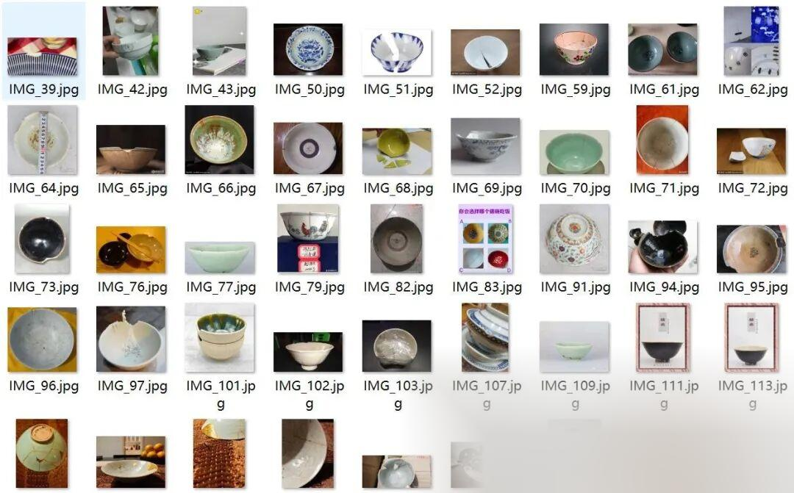
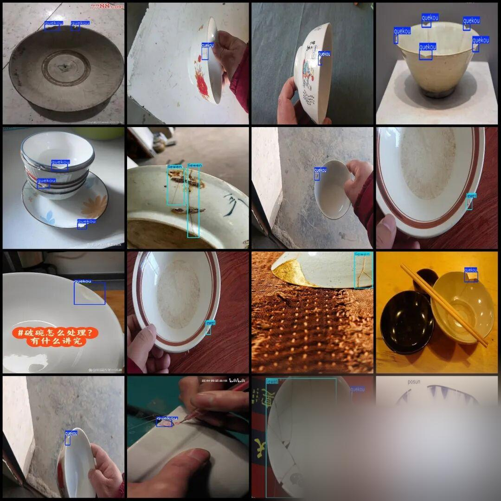

# Ceramic Bowl Chipping Defect Detection Dataset VOC+YOLO format with 266 images in 4 categories

Dataset format: Pascal VOC format + YOLO format (txt file without split path, only containing jpg images and corresponding VOC format xml files and yolo format txt files)

Number of images (number of jpg files): 266

Number of annotations (number of xml files): 266

Number of annotations (number of txt files): 266

Labeling category count: 4

Label category names (Note that the order of categories in the YOLO format does not correspond to this, but is based on the labels folder's classes.txt): ["liewen", "podong", "posun", "quekou"]

Number of boxes labeled in each category:

Liewen frame count = 125

Podong Frame Count = 2

Posun Frame Count = 8

Quekou Frames = 318

Total frame count: 453

Using labelImg:

Annotation rules: Draw a rectangle around the category.

Important Notice: No

Special : This dataset does not guarantee the accuracy or precision of the trained models or weight files. The dataset is provided with accurate and reasonable annotations only.

Image Preview:

Annotation example:

## Payment

Here is a pay link on Stripe ( https://buy.stripe.com/3cs8yP7sY87d0vu9AB ). Please contact me lonlonago@foxmail.com after funding $89, and I will send you a complete data files , thank you!

